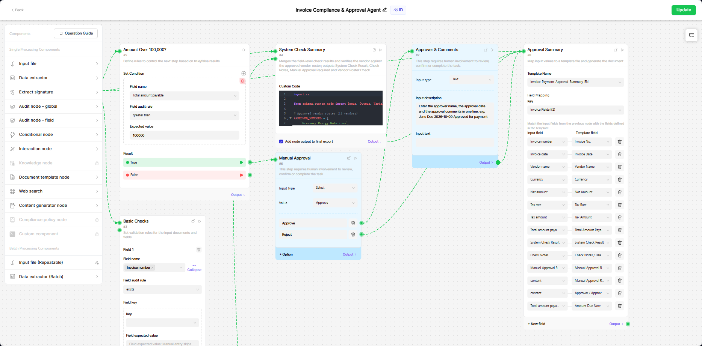
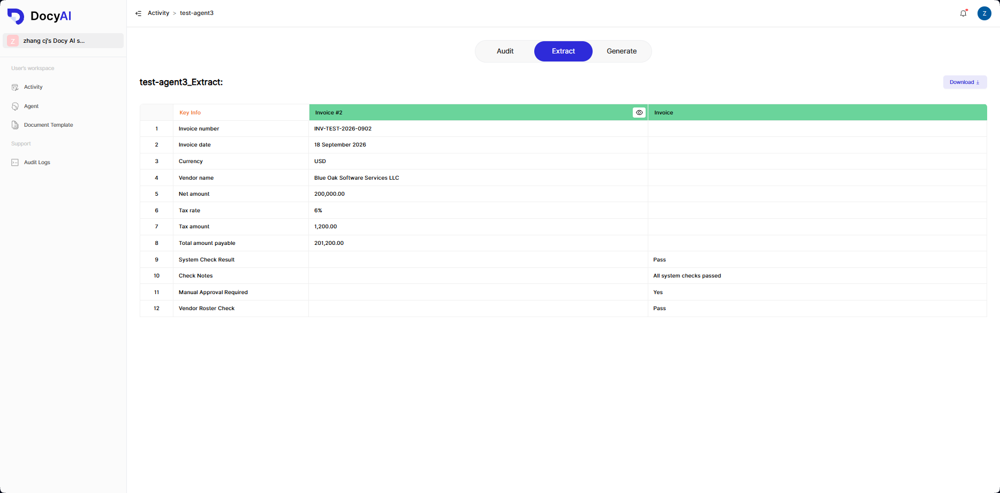
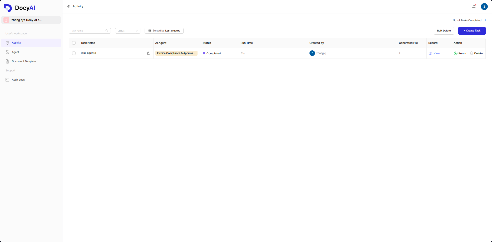

# Open Docy

> **The open-source Agent OS for decisions you can audit.**
> Open Docy is the self-hosted edition of Docy AI. Compose AI agents on a visual canvas from nodes that extract, check, branch, search, write and ask a person. Run them on documents (PDF, DOC/DOCX, XLS/XLSX, PPT/PPTX, JPG/JPEG/PNG, TXT, JSON, CSV, ZIP) on your own infrastructure, and keep the record of what each one decided and why — through the web UI and a REST API with webhook event push. The only runtime dependency is SQLite.
[](LICENSE.md)
[](https://www.python.org/)

https://github.com/user-attachments/assets/6fd1aaf4-0a96-4639-b97d-4a2a3293db0d

*Install Open Docy in 72 seconds: a real run on a clean Mac.*

If Open Docy is useful to you, a star on this repo helps other people find it.

Open Docy is the open-source edition of the Docy AI platform: proprietary modules (billing, marketplace) are stripped, and heavy runtime dependencies (Redis, RabbitMQ, Celery, PostgreSQL) are replaced with lightweight, self-contained alternatives.

---

## Contents

- [Features](#features) · [Use cases](#use-cases) · [Screenshots](#screenshots) · [Quick Start](#quick-start) · [Docker Compose](#docker-compose) · [CLI](#cli) · [Documentation](#documentation) · [Open Docy vs Docy AI](#open-docy-vs-docy-ai) · [What this project is not](#what-this-project-is-not) · [Contributing](#contributing) · [License](#license) · [Third-party licenses](THIRD_PARTY_NOTICES.md)

## Features

- **Build agents on a canvas** — compose agents from 12 node types (file input, data extraction, audit rules, conditionals, web search, content generation, document templates, interaction…), with drafts, publish and single-node debugging
- **See how every decision was made** — each node's output, every rule's expected and found value, a flowchart and a timestamped log for every run
- **Rules that explain themselves** — per-field rules (equals, contains, greater or less than, before, after); each result shows found, expected and reason, linked to where the value came from
- **Human-in-the-loop** — the Interaction node pauses a run at `Action Required` and resumes when someone answers; the answer is part of the record
- **Document templates** — upload DOCX or PDF, draw the fields, set font and borders; the template node fills them from upstream output
- **Batches and loops** — repeatable inputs and batch nodes process a folder of documents with one agent, grouped the way you upload them
- **Automate document work** — template-driven field extraction, table extraction, document audit, and report generation (PDF/DOCX/XLSX)
- **Watch tasks live** — SSE log stream per task and a full task state machine (`Not Started → In Progress → Completed / Action Required / Error / Canceled`)
- **Receive events** — register a webhook endpoint, get HMAC-signed task events (`task_status_changed`, `node_finished`, `task_finished`) with automatic retry
- **Integrate via REST** — tasks, agents, workspaces, files and webhooks, authenticated with user-scoped API keys (`X-API-Key`)
- **Trust the audit trail** — hash-chained event log with chain verification and offline verification; filter by action, resource and date, export CSV
- **Zero external services** — SQLite storage, disk-persistent async cache, built-in lightweight task queue and MQ

## Use cases

One runtime, any decision with rules behind it — these are the kinds of agents Docy AI runs today:

| Use case | What the agent does |
|---|---|
| Rebate and compliance checks | Check installation evidence against scheme rules, route exceptions to an assessor, produce the filing |
| Credit assessment | Read the application pack, test it against lending policy, escalate anything outside appetite |
| Invoice and PO matching | Match invoices to purchase orders in batches, hold mismatches for approval, export the result |
| Due diligence | Abstract leases and reports, flag missing clauses, write the investment summary |
| Contract and supplier review | Check contracts and signatures against policy, look up the supplier, record who approved |
| Briefings from sources | Pull named facts from the web, check them against your criteria, generate the briefing document |

## Screenshots


| | |
|---|---|
|  |  |
| *Agent canvas* | *Task monitoring & results* |



## Quick Start

### Prerequisites

- Python 3.11 – 3.13
- [uv](https://docs.astral.sh/uv/) (recommended) — all dependencies are pinned in `uv.lock`
- Node.js v20.19+ or v22.12+ with pnpm — required only for `docy build-web` (the frontend build; Vite 8 needs it). Install Node from https://nodejs.org and enable pnpm (`corepack enable pnpm` or `npm install -g pnpm`). On WSL, install the Linux toolchain (`sudo apt install nodejs npm && sudo npm install -g pnpm`) — Windows-side Node executables are ignored there.

### Install & run

```bash
# 1. Install virtual environment
uv venv --python <python_version>

# 2. Prepare the configuration (required before the first start):
#    copy the sample configs and replace the placeholder values
#    (secrets, API keys) with your own — see docs/configuration.md
cp settings.ini.sample settings.ini
cp .env.sample .env

# 3. Install dependencies
uv sync

# 4. Install the AI plugin (the pyarmor-obfuscated agent runtime, distributed separately)
uv run docy install-ai

# 5. Install LibreOffice — required by the AI plugin (Word/PPT/XLS → PDF
#    conversion) and by DOCX→PDF template conversion.
#    Windows: installed automatically via winget.
#    macOS/Linux: this only prints the package-manager command — run it
#    yourself (see the note below).
uv run docy install-libreoffice

# 6. Build the web UI (needs Node.js v20.19+ or v22.12+ and pnpm — see Prerequisites;
#    skip this step if you serve the API only)
uv run docy build-web

# 7. Start the server — runs migrations, serves the web UI, spawns the AI worker
uv run docy run
```

> **`docy install-libreoffice` platform behavior — why it only installs on Windows.**
> The command calls `winget`, which ships with Windows and handles elevation (UAC)
> itself. Linux has no single package manager (`apt`, `dnf`, `pacman` and `zypper`
> all differ), macOS has no built-in package manager (Homebrew is optional; the
> official installer is a DMG), and installing system packages requires elevated
> privileges — a project CLI should not request those on the user's behalf. So on
> macOS/Linux the command installs nothing; it prints the command to run and exits
> **0**, which means a successful exit code does **not** confirm LibreOffice is
> installed:
>
> - macOS: `brew install --cask libreoffice`
> - Debian/Ubuntu: `sudo apt-get install libreoffice`
> - Fedora: `sudo dnf install libreoffice`
>
> Run the printed command (or install from
> <https://www.libreoffice.org/download/download-libreoffice/>), then verify with
> `soffice --version`. On Windows, if `winget` is missing or the install fails, the
> command prints the manual download link and exits 1. The Docker image already
> ships LibreOffice — no action needed there.

> **Before the first start**, make sure you have updated the configuration items in
> `settings.ini.sample` and `.env.sample` (copied as `settings.ini` / `.env` above).
> The placeholders (`change-me`) must be replaced with your own secrets — the server
> refuses to start while they remain unchanged.

The server starts on `http://127.0.0.1:3000` (see `settings.ini`), opens the web UI in your browser, and serves the API under `/api/v1`. Storage defaults to the bundled local driver (zero external services); MinIO/S3 is optional via `[S3]` in `settings.ini` (see [Configuration](docs/configuration.md)). Check it is alive with:

```bash
curl http://127.0.0.1:3000/api/v1/common/health
# {"status":"healthy","service":"open-docy"}
```

Headless / server options:

```bash
uv run docy run --host 0.0.0.0 --port 3000 --no-browser      # serve without opening a browser
uv run docy run --conf-file /path/to/settings.ini            # use another config file
```

Next: [Getting started](docs/getting-started.md) walks through running the preloaded invoice agent — your first task.

## Docker Compose

A complete image (code + dependencies + encrypted AI plugin + prebuilt frontend, `linux/amd64`) is published on Docker Hub as `opendocy/open-docy` — users only need Docker Compose:

```bash
cp .env.sample .env   # fill in AI keys — only needed for agent tasks
docker compose up -d  # pulls opendocy/open-docy:latest automatically
```

Secrets are generated on first boot and persisted in the `docy-config` volume. AI credentials and the platform auth pair come from `.env` (compose auto-loads it); other settings are set through `DOCY_*` environment variables (`docker run -e` or the `environment:` section). See [Docker deployment](docs/docker-deployment.md) for the full reference — configuration, image build, MinIO/S3 switching and update flow.

> LibreOffice is baked into the image — the AI plugin requires it for Word/PPT/XLS → PDF conversion.

## CLI

The `docy` command ships a management CLI that operates directly on the local SQLite database — no server required:

```bash
uv run docy agent list --email user@example.com             # list a user's agents
uv run docy agent get --agent-id <id>                       # agent details
uv run docy activity list --email user@example.com          # list a user's tasks
uv run docy activity get --activity-id <id>                 # task details
uv run docy activity webhook --activity-id <id> --on|--off  # toggle webhook push
uv run docy api-key create --email user@example.com --name my-key   # create API key (shown once)
uv run docy webhook create --email user@example.com --endpoint https://your.host/hook  # register webhook
```

Other commands: `docy run`, `docy build-web`, `docy install-ai`, `docy install-libreoffice`, `docy stop-ai-worker`, `docy ai-worker`. Run `docy <command> --help` for details, or see [CLI reference](docs/getting-started.md#cli-reference).

## Documentation

| Document | What it covers |
|---|---|
| [Documentation index](docs/README.md) | All documentation in one place |
| [Getting started](docs/getting-started.md) | Installation, first run, first agent & task, CLI reference |
| [Configuration](docs/configuration.md) | `settings.ini`, environment variables, storage & log locations |
| [Deployment](docs/deployment.md) | Running as a server: headless mode, AI worker, reverse proxy |
| [Docker deployment](docs/docker-deployment.md) | Docker Compose: image build, configuration, storage switching |
| [API reference](docs/api/README.md) | REST integration: tasks, agents, workspaces, files, webhooks, event push, audit |
| [Troubleshooting](docs/troubleshooting.md) | Common errors and how to fix them |
| [Architecture](docs/architecture.md) | Layering, process model, storage and queue design |
| [Glossary](docs/glossary.md) | Terminology |
| [Security](SECURITY.md) | Reporting vulnerabilities, security model |
| [Contributing](CONTRIBUTING.md) | Conventions, development setup, PR process |
| [Changelog](CHANGELOG.md) | What changed in the OSE port, by date |

Interactive API docs (Swagger UI) are served at `/docs` while the server is running.

## Open Docy vs Docy AI

Open Docy is the free, self-hosted edition of the Docy AI Agent OS. Both editions use the same node types, so an agent designed in Open Docy carries over to Docy AI — cloud or on-premise — without redesign.

| Open Docy | Docy AI  |
|---|---|
| Agent canvas, drafts, publish, single-node debug | Everything in Open Docy, plus: |
| 12 node types, loops and batches | Build agents by chat — describe the workflow, get a draft on the canvas |
| Tasks, run logs, flowchart, results and downloads | Team spaces, members and custom roles |
| Human-in-the-loop interventions | Sealed decision records and decision replay |
| Document templates | OAuth (Google sign-in) |
| REST API keys and webhooks | |
| Audit log with CSV export | Knowledge, compliance-policy and custom-component nodes |
| Email and password sign-in, personal space | Versioned compliance policies and knowledge bases |
| | Pre-built agent library |
| | Tasks by email, task sharing, notifications |
| | Usage, budgets, spend limits; Google sign-in |

The knowledge, compliance-policy and custom-component nodes belong to the commercial edition. The app and task runtime are open source; the canvas editor UI ships as a prebuilt compiled snapshot (`src/frontend/lib/docyai-model/`) whose source is not included, and the extraction and AI logic inside each node ships compiled (see [below](#what-this-project-is-not)).

## What this project is not

- **No external services required or supported** — MySQL/PostgreSQL/Redis/RabbitMQ/Celery are intentionally replaced by SQLite, diskcache and the built-in queue; there are no drivers to configure them back.
- **No billing, marketplace or paid-feature flows** — stripped in the OSE, and not planned.
- **No OAuth client SDK / general request rate limiting** — login attempts are throttled per account and per IP; see the API docs for what is available.
- **No Windows 7 / Python < 3.11** — requires Python 3.11–3.13.
- **The `ai/` agent runtime is not open source** — it is distributed as a pyarmor-obfuscated plugin, installed with `docy install-ai`.
- **The canvas editor UI is not open source** — it ships as a prebuilt compiled snapshot (`src/frontend/lib/docyai-model/`); its source is not included in this repository.
- The rest of the codebase is MIT.

## Contributing

Contributions are welcome — see [CONTRIBUTING.md](CONTRIBUTING.md) for the conventions used in this codebase (route → service → crud layering, async rules, migration requirements). Participants are expected to follow the [Code of Conduct](CODE_OF_CONDUCT.md). For security issues, see [SECURITY.md](SECURITY.md) (report privately, not in a public issue).

## License

The source code in this repository is licensed under [MIT](LICENSE.md) © 2026 Docy AI Pty Ltd. The bundled compiled snapshots (the canvas editor kit under `src/frontend/lib/docyai-model/` and the `ai/` plugin) are distributed as binaries — their source is not part of this repository.

> **Note on the PDF feature:** PDF processing is backed by permissively licensed libraries only — [pypdfium2](https://pypi.org/project/pypdfium2/) (Apache-2.0/BSD-3) for text extraction/rendering/search, [pypdf](https://pypi.org/project/pypdf/) (BSD-3) for form reading/filling/creation, [pikepdf](https://pypi.org/project/pikepdf/) (MPL-2.0) for repair/compression/flattening and [reportlab](https://pypi.org/project/reportlab/) (BSD) for PDF generation. The former PyMuPDF (AGPL-3.0) dependency has been removed entirely, so no AGPL obligations apply.

Other third-party dependencies and their licenses (LGPL, MPL, Apache-2.0, proprietary) are listed in [THIRD_PARTY_NOTICES.md](THIRD_PARTY_NOTICES.md); the compiled frontend bundle ships its own inventory and license texts under [`src/frontend/`](src/frontend/THIRD_PARTY_NOTICES.md).
