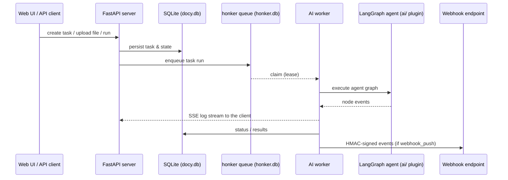

# Architecture

Open Docy is the open-source edition of a commercial product: the proprietary modules (billing, marketplace integrations) are stripped and every external service dependency (PostgreSQL, Redis, RabbitMQ, Celery) is replaced by a self-contained alternative. The only runtime dependency is SQLite.

## Process model

Two processes cooperate when the server starts:

```
docy run
├── main server (FastAPI + uvicorn)     serves REST, SSE, static frontend
│   └── supervisor (asyncio tasks)      watches the AI workers, respawns each
│                                       with exponential backoff after a crash
└── ai-workers (spawned processes)      consume the task queue, execute agents
```

- AI workers are spawned automatically — `DOCY_AI_WORKERS` sets the count (default 2, max 16). `DOCY_NO_AI_WORKER=1` skips spawning/supervising them (tasks queue up until `docy ai-worker` is started manually); `docy stop-ai-worker` stops running workers.
- Worker crash recovery: tasks are claimed under a lease (`claim_expires_at`); a crashed worker's in-flight task becomes re-claimable once the lease expires — up to 15 minutes, not seconds.

## Layering

New features follow a strict flow: **route → service → crud**.

| Directory | Responsibility |
|---|---|
| `api/v1/` | HTTP routes only — thin layer, no business logic |
| `services/` | Business logic per domain (auth, agent, workspace, activity, webhook, audit…) |
| `crud/` | Database access |
| `models/` | SQLModel table definitions (`tb_*.py`) |
| `schema/` | Request/response Pydantic models |
| `core/` | settings, lightweight MQ (`mq_server`/`mq_client`/`event`), SSE, log, storage drivers, shared utils |
| `common/` | Uniform response envelope and pagination helpers |
| `exceptions/` | Custom exceptions + handlers (registered in `main.py`) |
| `ai/` | LangGraph agent runtime — shipped as a pyarmor-obfuscated plugin, not open source |
| `alembic/` | Migration scaffolding — the OSE snapshot ships no version scripts; startup falls back to creating tables from the models |

## Task execution



- **Queue**: the built-in honker queue replaces RabbitMQ + Celery. Tasks are claimed under a lease (`visibility_timeout_s`); exceeding it lets another worker re-claim the task (see Troubleshooting).
- **Real-time logs**: task progress streams to clients over SSE; webhook push delivers `task_status_changed`, `node_finished` and `task_finished` events with `X-Webhook-Timestamp` + `X-Webhook-Signature: t=<ts>,v1=<hmac>` headers.
- **Human-in-the-loop**: interaction nodes pause the run and emit a "manual action required" state until input arrives.

## Storage

| Concern | Technology | Where |
|---|---|---|
| Relational data | SQLModel + SQLAlchemy + aiosqlite, WAL mode | `src/backend/docy/storage/docy.db` |
| Queue state | honker | `src/backend/docy/storage/honker.db` |
| Cache | cashews + diskcache (disk-persistent, async) | `src/backend/docy/storage/cache/` (per-task AI temp files use a per-user cache dir) |
| AI-side state | LangGraph checkpointer (`checkpoints.db`), bot sessions (`app.db`) | `src/backend/docy/storage/ai/` (override with `AI_DATA_DIR`) |
| User files | object-storage drivers under `core/storage_drivers/` (S3/MinIO-compatible or local driver) | per `[S3]` settings |
| Logs | loguru, separate files for server and AI worker | see [Configuration → Locations](configuration.md#locations) |

## API conventions

- All routes are under `/api/v1` and wrap responses in the uniform envelope: `{"data": …, "msg": …, "status": …, "code": <int>}` — success (`code: 200`), validation errors (`code: 400`), HTTP exceptions (`code: <status>`).
- Pagination uses the `results` key: `{"count": n, "next": null, "previous": null, "results": [...]}`.
- Auth: bearer tokens for the web UI, `X-API-Key` for programmatic access.
- Interactive schema: Swagger UI at `/docs`, OpenAPI JSON at `/openapi.json`.

## Audit trail

Business operations (agent/task create & delete, template changes, workspace member changes) append to a **hash-chained** event log (`audit` module): each event hashes the previous one, and a standalone verifier script can validate the chain offline. See `docs/api/` and the audit menu (Support → Audit Logs) in the UI.

## Notable constraints for developers

- **Import order**: any process importing `docy.ai` must import `docy.honker_db` (or `docy.core.aiexecutor`) first, or the pyarmor runtime fails. Scripts and smoke tests must follow this.
- **Schema management**: the OSE snapshot ships no Alembic version scripts (`alembic/versions/` is empty), so startup creates the tables from the models via `create_db_and_tables()`; if version scripts are added, the Alembic migration path runs instead.
- **Fully async request path**: no blocking calls (`requests`, sync file IO) — use `httpx`/`aiohttp`/`aiofile`.
- **API compatibility**: endpoints ported from the commercial edition (`src/old_backend/`) keep their exact contract — see [CONTRIBUTING.md](../CONTRIBUTING.md).

## Frontend serving

`docy run` serves the built SPA (history-mode fallback) from `src/frontend/dist-web` in a source checkout (or `docy/web/static` from the wheel). `--frontend-dev` runs the Vite dev server with an `/api` proxy for HMR; `docy build-web [--api-base <url>]` rebuilds the bundle for static hosting.

The frontend ships as Vue application source, with one deliberate exception: the **canvas editor** (the flow-editor UI for composing agents) is distributed as a prebuilt compiled snapshot under `src/frontend/lib/docyai-model/` — its source is not open and not included in this repository. The build (`docy build-web`) uses the snapshot as-is.
