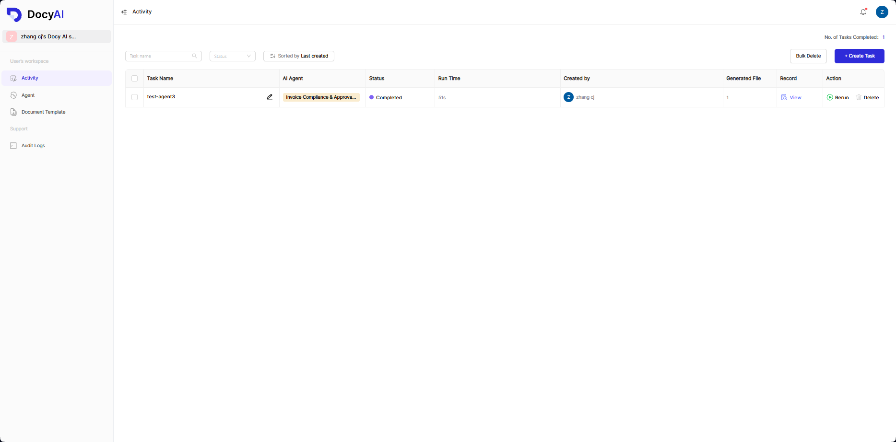
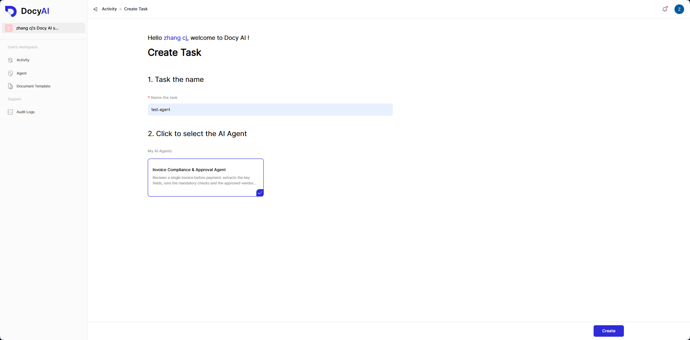
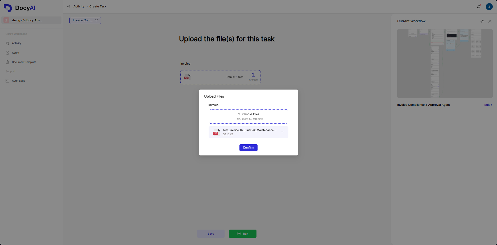
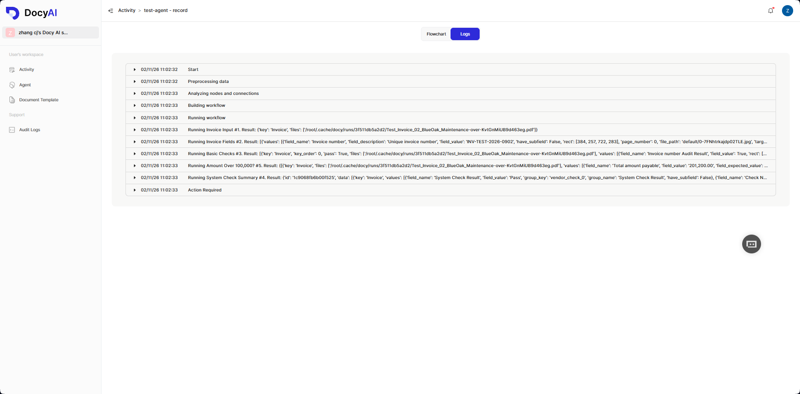
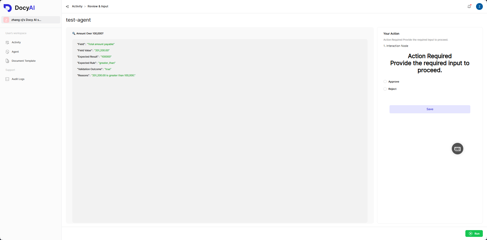
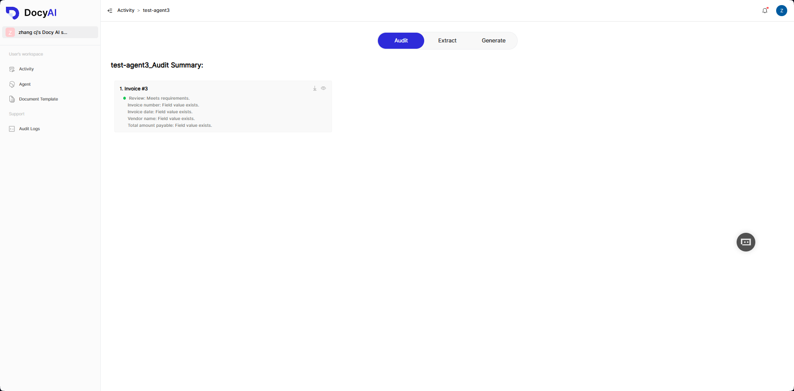
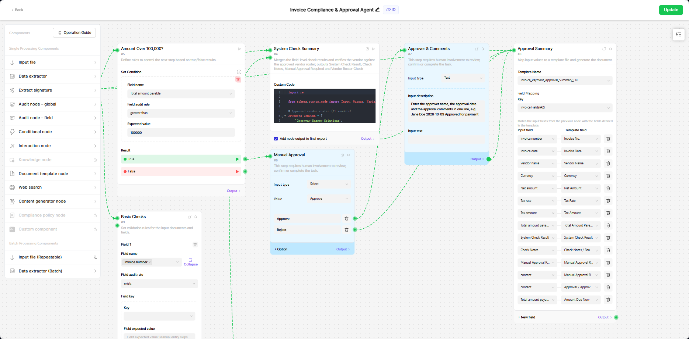

# Getting Started

This guide takes you from a clean machine to your first agent run. Every command below has been verified against the current codebase.

> **Prefer Docker?** A complete image (code, dependencies, encrypted AI plugin, prebuilt frontend) is published on Docker Hub — `docker compose up -d` replaces the manual install below. See [Docker deployment](docker-deployment.md).

## 1. Prerequisites

- **Python 3.11 – 3.13**
- **[uv](https://docs.astral.sh/uv/)** — the project pins all dependencies in `uv.lock`; `uv` makes the setup one command.
- **LibreOffice** — required by the AI plugin (Word/PPT/XLS → PDF conversion) and by DOCX→PDF template conversion. `docy install-libreoffice` installs it automatically on Windows (winget); on macOS/Linux it only prints the package-manager command to run (see step 2 and the CLI reference).

## 2. Install

```bash
git clone <your-repo-url> open_docy
cd open_docy

uv sync                       # installs all pinned dependencies into .venv
uv run docy install-ai        # downloads the pyarmor-obfuscated AI plugin into src/backend/docy/ai/
uv run docy install-libreoffice   # required by the AI plugin and DOCX→PDF template conversion
```

> **On Windows**, `docy install-libreoffice` installs LibreOffice via winget. **On macOS/Linux it installs nothing** — it prints the command to run (`brew install --cask libreoffice`, `sudo apt-get install libreoffice`, or `sudo dnf install libreoffice`) and exits **0**, so a successful exit code does not mean LibreOffice is installed. There is no universal Linux package manager, Homebrew is optional on macOS, and system installs need elevated privileges — run the printed command yourself and verify with `soffice --version`.

> LibreOffice installs to standard locations that the server detects automatically. If you install it to a custom location, add its `program` directory to the system PATH — custom paths can only be found through PATH.

> If `ai/` already exists, `install-ai` asks before backing it up and replacing it — answer `n` to keep the current one.

## 3. Start the server

```bash
uv run docy run
```

This single command:

1. creates/upgrades the database schema (bundled Alembic migrations run at startup — `src/backend/docy/storage/docy.db` appears on first run; without migration scripts the server falls back to creating tables from the models),
2. starts the FastAPI server on `http://127.0.0.1:3000`,
3. spawns the AI worker process (the background consumer that executes agent runs),
4. serves the web UI and opens it in your browser.

> The server refuses to start while `change-me` placeholder secrets remain in `settings.ini`, or when the `[DEFAULT] secret` is not a valid AES key length (16/24/32 bytes) — fix them before the first run (see [Configuration](configuration.md)).

Verify it is healthy:

```bash
curl http://127.0.0.1:3000/api/v1/common/health
# {"status":"healthy","service":"open-docy"}
```

Useful variations:

```bash
uv run docy run --no-browser                 # don't open a browser (servers, CI)
uv run docy run --host 0.0.0.0 --port 9000   # different host/port
uv run docy run --conf-file settings.ini     # explicit config file
```

Swagger UI is available at `http://127.0.0.1:3000/docs`.

## 4. Create your account

Open `http://127.0.0.1:3000` and **register** an account (email + password), then log in.


On first login, the system automatically:

- creates your **personal workspace**,
- imports a ready-made **Invoice Compliance & Approval Agent** into it (from `sample/sample.docy`).



## 5. Run your first task

The preloaded agent reviews a single invoice before payment: it extracts the key fields, runs the mandatory checks and the approved-vendor roster check, routes invoices above 100,000 to manual approval, and produces an approval summary document.

1. **Create a task.** Open the **Activity** page, click **Create**, and select **Invoice Compliance & Approval Agent** as the agent.

   

2. **Upload a sample invoice.** Pick any file from `sample/sample-input/` — e.g. `Test_Invoice_02_BlueOak_Maintenance-over.pdf` — and upload it into the **Invoice Input** node.

   

3. **Run.** Click **Run** and watch the live log stream — the nodes execute in order (`Invoice Fields` extraction → `Basic Checks` → `System Check Summary` → the amount check), and the status advances through `Queued → In Progress → Completed`.

   

4. **Answer the human step (only for the "over" invoice).** If you uploaded `Test_Invoice_02_BlueOak_Maintenance-over.pdf`, the amount exceeds 100,000, so the run pauses at the **Manual Approval** node and the task status becomes `Action Required`. Open the task, pick **Approve** (or **Reject**), fill in the **Approver & Comments** field (e.g. `Jane Doe 2026-10-09 Approved for payment`), and continue the run. With any other sample file the amount stays below the threshold, and the run completes without stopping.

   

5. **Open the result.** The **Approval Summary** node generates a PDF carrying the extracted fields, the check results and the approval record.

   

## 6. Build your own agent

1. Click **Create agent** on the workspace home and choose a template or a blank canvas.
2. Drag nodes onto the canvas and connect them — e.g. `InputFile` (the uploaded document) → a content-generation node → an `InteractionNode` (asks a human for input mid-run).
3. Save, then publish the agent.
4. Create a task for the agent, upload a file, and run it exactly like the sample agent above.



See the [architecture document](architecture.md#task-execution) for what happens under the hood while a task runs.

## 7. Integrate via API or webhooks

- Create an API key (`docy api-key create`) and call the REST API — start with [docs/api/quick-start.md](api/quick-start.md).
- Register a webhook (`docy webhook create`) to receive HMAC-signed task events on your own endpoint — see [docs/api/webhooks.md](api/webhooks.md).

## CLI reference

All management commands connect directly to the local SQLite database — the server does not need to be running. Run `docy <command> --help` for the full option list.

### `docy run`

`docy` with no arguments is equivalent to `docy run` — it starts the server with the defaults.

| Option | Meaning |
|---|---|
| `--host` / `--port` | Bind address / port |
| `--conf-file` | Path to the settings `.ini` file |
| `--log-level`, `--log-dir` | Logging verbosity and directory |
| `--no-browser` | Don't open the browser on startup |
| `--build-web` | Rebuild the frontend before serving |
| `--static-dir` | Serve the frontend from a specific build directory |

### `docy install-ai`

Downloads the AI plugin package for the current Python version and platform and installs it into `src/backend/docy/ai/`.

| Option | Meaning |
|---|---|
| `--server` | Base URL of the package server (default: `https://agent.docyai.com`, path `/reg-api/ai-package/download`) |
| `--python-version` | Request a specific build, e.g. `313` (defaults to the running interpreter) |
| `--platform` | Request a specific platform build (defaults to the current platform) |
| `--yes` / `-y` | Replace an existing `ai/` without asking |

### `docy agent`

```bash
uv run docy agent list --email user@example.com   # table: id / name / description / status
uv run docy agent get --agent-id <id>             # one agent's details
uv run docy agent export --agent-id <id>          # package the agent into a .docy archive
uv run docy agent import --file agent.docy --email user@example.com
```

> `agent export` packages the agent together with every file it references (templates, documents, assets) into a self-contained `.docy` archive. It asks for confirmation and writes to `sample/<agent name>.docy` unless `--output <path>` is given. `agent import` imports the package into the target user's personal workspace; `--name` overrides the imported agent's name. Both run offline against the local database — no server required.

### `docy activity`

```bash
uv run docy activity list --email user@example.com          # table: id / name / creator / status / webhook_push
uv run docy activity get --activity-id <id>                 # one task's details
uv run docy activity webhook --activity-id <id> --on        # enable webhook push for a task
uv run docy activity webhook --activity-id <id> --off       # disable it
```

### `docy api-key`

```bash
uv run docy api-key create --email user@example.com --name my-key   # prints the full key ONCE
uv run docy api-key list --email user@example.com                    # masked list
uv run docy api-key update --api-key-id <id> --name new-name
uv run docy api-key delete --api-key-id <id>
```

> The `--email` options look up the user in `auth_user`; `create`/`list` accept `--user-id` instead. After creation the key is shown only once — store it immediately.

### `docy webhook`

```bash
uv run docy webhook create --email user@example.com --endpoint https://your.host/hook --description "prod"
uv run docy webhook list --email user@example.com
uv run docy webhook get --webhook-id <id>
uv run docy webhook update --webhook-id <id> --endpoint https://new.host/hook --status ACTIVE
uv run docy webhook rotate --webhook-id <id>      # rotate the HMAC secret
```

> **Each user can have at most one webhook record.** Creating a second one fails with "A user can only create one webhook record." — use `update` to change it and `rotate` to change the secret.

### Other commands

```bash
uv run docy ai-worker              # run the AI queue consumer in the foreground (debugging)
uv run docy stop-ai-worker         # stop all running AI worker processes
uv run docy build-web              # build the frontend SPA into src/frontend/dist-web
uv run docy build-web --api-base http://192.168.1.100:3000   # bake a backend base URL into the bundle
uv run docy install-libreoffice    # install LibreOffice (required by the AI plugin and docx→pdf template conversion)
```

> `docy install-libreoffice` performs an automatic install only on Windows (winget). On macOS/Linux it prints the package-manager command and exits 0 without installing anything — run the printed command yourself and verify with `soffice --version`.

## Next steps

- [Configuration](configuration.md) — ports, secrets, storage locations, environment variables
- [API reference](api/README.md) — everything available over REST
- [Troubleshooting](troubleshooting.md) — common startup and runtime errors
- [Architecture](architecture.md) — how the pieces fit together
